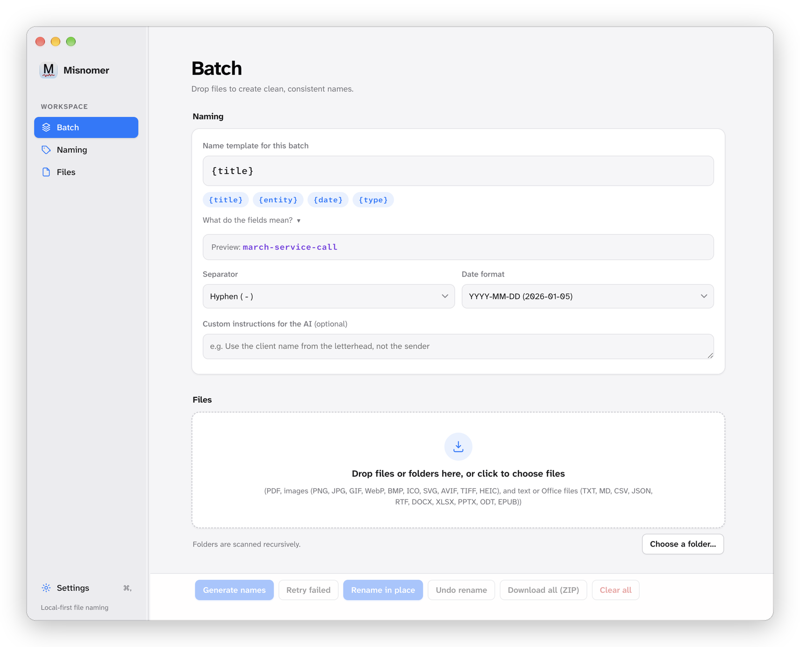

# Misnomer

A small Electron desktop app that looks at your files and gives them meaningful, consistent names.

Drop in a batch of documents and images, pick a naming template, and the app reads each file with a vision model and proposes a name built from what it actually sees. For example, with a template like `{date}-{entity}-{type}-{title}`, an invoice from Acme dated 2026-03-01 becomes `2026-03-01-acme-invoice-march-service-call`.

Everything runs locally except the files you send to a cloud model. Your API key is stored encrypted in the OS keychain via Electron's `safeStorage`, never in plain text.



---

## Current features

- **Batch processing** — drop a folder's worth of files at once, watch per-file status with a batch progress bar, and fix any name inline before saving. The action bar and table header stay pinned while long batches scroll.
- **Light and dark themes** — choose **Auto** (follow the system setting, the default), **Light**, or **Dark** in Settings; the choice is saved with the rest of the app settings.
- **Two engines**
    - **Cloud API** — Anthropic, OpenAI, Google Gemini, xAI, DeepSeek, OpenRouter, Groq, Mistral, or Together AI. Each provider keeps its own encrypted key and model choice.
    - **Local model** — runs on your Mac through `llama-server` (llama.cpp) with a vision GGUF model plus a matching `mmproj` projector. Nothing leaves the machine.
- **Live model list** — the model dropdown is populated from the selected provider's own catalogue, so only models your key can actually reach are offered.
- **Connection check** — Settings shows a green, amber, or red dot for the selected provider, with the reason when a key fails.
- **Structured output** — requests a JSON schema where the provider supports it, and falls back to plain JSON parsing where it does not.
- **Usage and cost** — every engine reports input and output token counts, totalled across the batch, with an estimated cost when the selected model has a known list price. Local runs show no API cost.
- **Naming templates** — compose names from `{date}`, `{entity}`, `{type}`, and `{title}` with a configurable separator, plus any custom fields you define. New installs start with just `{title}`; add fields as needed.
- **Live template preview** — see the filename your template produces as color-coded tokens, with unknown placeholders flagged and the sample date rendered in the selected date format.
- **Date formats** — `YYYY-MM-DD`, `MM-DD-YYYY`, `DD-MM-YYYY`, `YYYYMMDD`, `YYYY-MM`, or `YYYY`.
- **Custom fields** — define your own values (e.g. `amount`, `category`) and use them as template placeholders; the request schema is generated to match.
- **Custom instructions** — add free-text guidance per batch (e.g. "use the client name from the letterhead, not the sender").
- **Presets** — save and switch between template + separator + date format + instructions + fields combinations.
- **Safe output** — duplicate names within a batch are auto-suffixed (`-2`, `-3`) and illegal filename characters are stripped.
- **Export** — save a copy of a single row, or export the whole batch as a ZIP. Large exports stream from disk with live progress and a **Cancel ZIP** button.
- **Auto-update** — the packaged app checks GitHub Releases on launch, downloads a new version in the background, and offers a restart when it is ready. Installing an update requires a signed, notarized build; unsigned builds can only be updated by downloading a new DMG.
- **In-place rename** — rename files where they live. Collisions are resolved against what is already in each folder, so nothing is overwritten.
- **EXIF capture-date fallback** — when a photo has no visible date, the capture date written by the camera is read from EXIF metadata and formatted with your chosen date format.
- **Thumbnail previews** — every image and PDF row shows a thumbnail of its first page, generated only when the row scrolls into view and cached for reuse. Hover for the original filename, and click or press Enter for a larger view; text and Office rows show a file-type badge.
- **Responsive on large batches** — folder scans, file reads, saves, and format conversions run asynchronously in the main process, and thumbnails decode a few at a time instead of all at once.
- **Keyboard and screen-reader friendly** — visible focus rings, a keyboard-operable drop zone and previews, labelled dialogs, and polite live announcements for status and progress.
- **Undo** — every rename batch is recorded; walk the stack backwards to restore original names.
- **Folder support** — drop files or folders anywhere in the window, or use **Choose a folder…**, and folders are scanned recursively in the background while the window stays responsive. The empty state previews the filename your current template will produce.
- **Progress and cancel** — a running count of processed files, and a Cancel button that aborts the in-flight request.
- **Pause/resume** — an error pauses the batch, and the specific reason appears under the affected file's name so you can fix it, skip that file, or continue.
- **Automatic retry** — rate limits, overload, transient server errors, and network timeouts are tried up to 4 times. The provider's `Retry-After` is honored, the row shows the wait, and the final message says what happened and how many attempts were made.
- **Retry failed rows** — the **Retry failed** button re-queues only the rows that errored, leaving finished work untouched.
- **Regenerate after changes** — changing the template, separator, date format, custom instructions, custom fields, engine, provider, or model re-enables **Generate names** as **Generate new names**, so the same batch can be re-processed without re-adding files. A full regeneration replaces manually edited names with the new result.

## Supported file types

| Type            | Extensions                                                                                   | How it is read                                                                                                                                                               |
| --------------- | -------------------------------------------------------------------------------------------- | ---------------------------------------------------------------------------------------------------------------------------------------------------------------------------- |
| Documents       | `.pdf`                                                                                       | Sent as a native document to Anthropic and Gemini. Providers that speak OpenAI chat completions cannot take a PDF, so the first 2 pages are rendered to JPEG images instead. |
| Images (native) | `.png`, `.jpg`, `.jpeg`, `.gif`, `.webp`                                                     | Sent to the model directly                                                                                                                                                   |
| Images (canvas) | `.bmp`, `.ico`, `.svg`, `.avif`                                                              | Chromium can decode these but the model APIs won't accept them, so they are re-encoded to JPEG in the app. The file on disk keeps its original format.                       |
| Images (sips)   | `.tif`, `.tiff`, `.heic`, `.heif`                                                            | Chromium cannot decode these at all, so macOS `sips` converts them to JPEG in the main process. macOS only.                                                                  |
| Text            | `.txt`, `.md`, `.markdown`, `.csv`, `.tsv`, `.json`, `.log`, `.yml`, `.yaml`, `.srt`, `.vtt` | Read as UTF-8 and sent in the prompt                                                                                                                                         |
| Markup          | `.html`, `.htm`, `.xml`, `.rtf`                                                              | Tagged content is stripped down to readable text before being sent                                                                                                           |
| Office / ebooks | `.docx`, `.xlsx`, `.pptx`, `.odt`, `.epub`                                                   | These are ZIP containers; the relevant XML parts are unzipped with `jszip` and reduced to text                                                                               |

Text is capped at 12,000 characters per file before it goes into a prompt. The file picker is limited to these formats, and the drop zone lists anything else as skipped.

Photos with no printed or visible date fall back to the capture date stored in EXIF metadata. The reader handles JPEG, PNG, WebP, and TIFF directly, and scans other containers such as HEIC for the EXIF block. The fallback only fills an empty date — a date the model can see always wins — and the result is formatted with the batch's date-format setting.

## Requirements

- macOS (packaging targets macOS DMG and ZIP)
- Node.js 24+ and npm (for development; matches `.nvmrc` and CI)
- **For the cloud engine:** an API key for whichever provider you choose
- **For the local engine:** `brew install llama.cpp`, then a vision `.gguf` model and its matching `mmproj` `.gguf`

## Getting started

```bash
git clone <your-repo-url>
cd misnomer
npm install
npm start
```

### Configure an engine

1. Click **Settings**.
2. Under **Engine**, choose **Cloud API** or **Local model**. Only the section for the engine you picked is shown.
3. For **Cloud API**:
    - Pick a **Provider**.
    - Paste that provider's API key and click **Save**. The key is encrypted with the OS keychain and stored per provider.
    - Watch the status dot: amber while it checks, green when the key works, red with the provider's message when it does not.
    - Choose a **Model** from the dropdown. The list is fetched from the provider, so it only shows models your key can reach. **Refresh** re-fetches it.
4. For **Local model**, choose the model `.gguf`, the `mmproj` `.gguf`, and (optionally) the `llama-server` binary. If the binary lives in Homebrew's standard location, it is auto-detected.
5. Click **Done**, press Esc, or click anywhere outside the dialog to close it. Settings persist to your Electron `userData` directory.

## Supported providers

| Provider      | API family              |
| ------------- | ----------------------- |
| Anthropic     | Messages API            |
| Google Gemini | `generateContent`       |
| OpenAI        | OpenAI chat completions |
| xAI           | OpenAI chat completions |
| DeepSeek      | OpenAI chat completions |
| OpenRouter    | OpenAI chat completions |
| Groq          | OpenAI chat completions |
| Mistral       | OpenAI chat completions |
| Together AI   | OpenAI chat completions |

Most providers expose an OpenAI-compatible endpoint, so adding one is a single entry in `renderer/providers.js`.

### Token and cost estimates

Token usage is read from every provider response and totalled for the current batch. Costs come from `pricing/pricing.json`, which combines exact model prices generated from the [LiteLLM pricing dataset](https://github.com/BerriAI/litellm) with a small set of curated family fallbacks. A scheduled GitHub Action refreshes the exact entries weekly and opens a PR; you can run the same update locally with `npm run pricing:update`.

Models that are not in either source still show token counts, just without a dollar estimate; OpenRouter is token-only because its per-model prices vary. The local engine reports tokens with no API cost. Prices are estimates, not invoices — vendors change them and add new models regularly, so check your provider's billing page for exact charges.

GitHub disables scheduled workflows after 60 days without repository activity. If that happens, re-enable **Update pricing** from the Actions tab or run it manually with **Run workflow**.

> Upgrading from a single-provider build? Your existing key and model are migrated to Anthropic automatically on first launch.

### Using it

1. Drop files or a folder onto the drop zone, click it to browse, or use **Choose a folder…**. The picker accepts every supported format, and folders are scanned recursively.
2. Adjust the template, separator, date format, and any custom instructions.
3. Click **Generate names**. Each row updates as it finishes, and the running token total (with a cost estimate where available) appears next to the progress counter.
4. Edit any name you don't like.
5. Click a thumbnail (or focus it and press Enter) to preview an image or PDF; Esc or a click outside closes it.
6. Click **Rename in place** to rename the files where they are, or use **Save copy** / **Download all (ZIP)** to export instead.

Changing any naming input after a batch finishes turns **Generate names** into **Generate new names**. Click it to re-process every file with the updated settings; this replaces any names you edited by hand. Changing the inputs back to their previous values disables the button again.

Renames are confirmed before anything happens and never overwrite an existing file: if the name is already taken in that folder, it gets a `-2`, `-3` suffix. **Undo rename** reverts the most recent batch and can be pressed repeatedly to walk back through the session.

### When a file fails

Processing pauses at the first failure, but the batch is not lost. The reason for each failure appears under the file's name in the table; the card at the top points you back to it. **Retry failed** re-queues only the rows that failed, **Skip this file** moves past the current one, and **Resume** continues the rest.

Messages are written to be actionable:

- **Provider limits** — a file over the provider's limit (5 MB per image and 32 MB per request for Anthropic) is reported with its actual size. Retrying will not help until the file is smaller, so save a smaller copy or switch providers.
- **Rate limits and outages** — 429 and 5xx responses are retried automatically. The row shows the wait, and the final message says how many attempts were made.
- **Model replies** — a cut-off, empty, or invalid reply is reported as such instead of as a JSON error. Retry, or choose a different model in Settings.
- **Rename failures** — permission problems, missing files, and names already in use are reported in plain language.

### Keyboard shortcuts

| Shortcut                      | Action                                                    |
| ----------------------------- | --------------------------------------------------------- |
| `Cmd+,` / `Ctrl+,`            | Open Settings                                             |
| `Cmd+O` / `Ctrl+O`            | Add files                                                 |
| `Cmd+Enter` / `Ctrl+Enter`    | Generate names                                            |
| `Cmd+Option+Z` / `Ctrl+Alt+Z` | Undo the last rename, when focus is not in a text field   |
| `Esc`                         | Cancel a running batch, when focus is not in a text field |

## Naming template reference

| Placeholder  | Fills with                                                          |
| ------------ | ------------------------------------------------------------------- |
| `{title}`    | A 2–5 word description of what the file is                          |
| `{entity}`   | The vendor, company, or person tied to the document, if any         |
| `{date}`     | The document's date, formatted per the date-format setting          |
| `{type}`     | The document type, e.g. `invoice`, `receipt`, `screenshot`, `photo` |
| `{whatever}` | Any custom field you defined in Settings                            |

Values are lowercased, accent-stripped, and separated by the chosen separator. Empty placeholders collapse cleanly, so a missing date never leaves a stray `--` in the name, and an unknown placeholder fills empty rather than leaking its own name into the filename.

## Development

```bash
npm test      # unit tests for every pure module (node --test)
npm run lint  # ESLint
npm run icons # regenerate the app, Dock, and sidebar icons from build/icon.icon
npm run pricing:update # refresh model prices from the LiteLLM dataset
npm run format # Prettier, writes changes in place
```

The logic worth testing lives in small modules that work in both the renderer and Node:

- `renderer/naming.js` — slugging, template filling, filename sanitizing, duplicate resolution
- `renderer/extract.js` — pulling text out of Office/ebook/HTML/RTF files
- `renderer/rename.js` — path handling, collision-aware rename planning, and undo replay
- `renderer/providers.js` — the provider registry, request shapes, model-catalogue parsing, and settings migration
- `renderer/exif.js` — EXIF capture-date parsing and date-format rendering
- `renderer/zip.js` — archive entry naming and duplicate resolution
- `renderer/zip-archive.js` — streaming ZIP creation, progress, and cancellation (Node only)

Each is covered by its own test file. Run the tests before changing any of them.

Filesystem work in the main process — recursive folder scans, file reads, directory listings, saves, `sips` conversion, and ZIP streaming — is asynchronous, so the UI stays responsive. Thumbnails are produced lazily for visible rows, three at a time, and cached by path.

### Icons

`build/icon.icon` is the Icon Composer source. It holds both artwork variants: the light layer shows in light appearance and the dark layer shows in dark appearance. `build/icon.icns` is generated from it and is what `electron-builder` ships; pointing the build at the `.icon` directly would require Xcode 26+, while the committed `.icns` builds with Command Line Tools alone. The ICNS and development Dock PNG use Apple's macOS icon grid (artwork inset to 824 of 1024 pixels) so they match the size of neighboring Dock icons; the sidebar images stay edge to edge inside their own tile.

After editing the document in Icon Composer, regenerate everything with:

```bash
npm run icons
```

The script needs Icon Composer installed and uses the Atkinson Hyperlegible Next font that the artwork's text references.

## Building a distributable

```bash
npm run dist       # current architecture
npm run dist:all   # Intel + Apple Silicon
```

These produce DMG and ZIP artifacts plus `latest-mac.yml` in `dist/`. The ZIP and `latest-mac.yml` are what `electron-updater` consumes; the DMG remains the manual install.

Both scripts build an unsigned app that is **ad-hoc signed** (`-c.mac.identity=-`), which is the minimum for Apple Silicon builds to launch. That is enough to publish a working release without an Apple Developer account, with two caveats: Gatekeeper quarantines the download on first launch, and auto-update cannot install because macOS requires a Developer ID signature.

### Installing an unsigned build

1. Open the DMG and drag **Misnomer** into **Applications**.
2. The first launch is blocked. Open **System Settings → Privacy & Security**, scroll to the bottom, and click **Open Anyway** (or right-click the app and choose **Open**).
3. If macOS instead reports that the app "is damaged and can't be opened", the quarantine flag is still set. Clear it with:

```bash
xattr -dr com.apple.quarantine /Applications/Misnomer.app
```

To update, download the newer DMG and replace the app. Settings shows _This build is not signed, so macOS cannot install updates_ when the updater finds a release it cannot apply.

### Signed and notarized builds

The build is signing-ready: Hardened Runtime is enabled, and `npm run dist:signed` (or `npm run dist:signed:all`) turns on electron-builder's notarization step. Signed releases require an Apple Developer Program membership and a **Developer ID Application** certificate.

Add these secrets under **Settings → Secrets and variables → Actions**:

| Secret             | Value                                                        |
| ------------------ | ------------------------------------------------------------ |
| `CSC_LINK`         | Base64-encoded `.p12` certificate, including its private key |
| `CSC_KEY_PASSWORD` | Password for the `.p12`                                      |
| `APPLE_API_KEY`    | Base64-encoded App Store Connect `.p8` key                   |
| `APPLE_API_KEY_ID` | App Store Connect key ID                                     |
| `APPLE_API_ISSUER` | App Store Connect issuer ID                                  |
| `APPLE_TEAM_ID`    | 10-character Apple Developer team ID                         |

Alternatively, use `APPLE_ID` and `APPLE_APP_SPECIFIC_PASSWORD` instead of the API-key secrets. The release workflow builds the ad-hoc signed pair when signing credentials are absent and a signed, notarized pair when they are present, then verifies the signature and stapling ticket before uploading.

### Publishing a release

The `CI` workflow does the whole release: it tests the tag, builds Intel and Apple Silicon DMGs and ZIPs on macOS, signs and notarizes when the Apple secrets are configured, and attaches the artifacts plus `latest-mac.yml` to a GitHub release. Without those secrets the tag still publishes the ad-hoc signed build described above, so an Apple Developer account is optional.

1. Make sure the tree is clean and the checks pass locally (`npm test && npm run lint`).
2. Bump the version and create the tag: `npm version patch` (or `minor` / `major`).
3. Push it: `git push --follow-tags`.
4. Watch the run: `gh run watch` (one-time `gh auth login` first).
5. Open the published release: `gh release view v1.0.0 --web`.

The release carries `Misnomer-<version>-arm64.dmg`, `Misnomer-<version>-x64.dmg`, the matching ZIPs used by the updater, `latest-mac.yml`, and the `.blockmap` files. To review a release before it goes public, add `draft: true` to the `softprops/action-gh-release` step and publish the draft afterwards.

To publish a locally built copy instead of using CI:

```bash
npm run dist:all
gh release create v1.0.0 --generate-notes dist/*.dmg dist/*.zip dist/latest-mac.yml dist/*.blockmap
```

Add `--prerelease` while a build is still being shaken out. Installed apps discover releases through `electron-updater`; the first updater-enabled release must be installed manually.

For a local signed build, export the same environment variables and run:

```bash
npm run dist:signed:all
```

## Project layout

```
build/
  icon.icon/           Icon Composer source with light and dark appearance layers
  icon.icns            Generated macOS app icon used by electron-builder
  icon-512.png         Generated Dock icon used in development
main.js                Electron main process: IPC handlers, model calls, usage capture, settings, async file I/O
preload.js             contextBridge surface exposed to the renderer as window.api
renderer/
  index.html           Markup, styling, and the preview dialog
  assets/
    icon-light.png     Sidebar brand artwork for light appearance
    icon-dark.png      Sidebar brand artwork for dark appearance
  naming.js            Pure naming logic: slug, template fill, sanitizing, dedupe
  extract.js           Text extraction from text, markup, and Office/ebook containers
  providers.js         Provider registry, request shapes, model parsing, pricing, settings migration
  errors.js            Error translation: HTTP/transport/model-output/limit messages, retry policy
  exif.js              EXIF capture-date reader and date-format rendering
  rename.js            Path handling, rename planning, and undo replay
  zip.js               Pure archive entry naming and duplicate resolution
  zip-archive.js       Streaming ZIP writer used by the main process
  thumbs.js            Lazy thumbnails and full-size image/PDF previews
  table.js             Results table rows, statuses, collision hints, usage totals
  preview.js           Template chips, token preview, and custom fields
  settings.js          Settings dialog, theme/engine, provider keys/models, presets
  app.js               Orchestration: file intake, analysis, renaming, progress, dialogs, shortcuts
  updates.js           Auto-update banner and Settings status
  export.js            ZIP export UI, progress, and cancellation
pricing/
  pricing.json         Exact model prices plus curated family fallbacks
scripts/
  build-icons.js       Regenerates icon.icns and the PNG icons from build/icon.icon
  pricing-lib.js       Provider mapping and validation for the pricing updater
  update-pricing.js    Refreshes pricing.json from the LiteLLM dataset
.github/workflows/
  pricing.yml          Weekly pricing refresh that opens a PR
  ci.yml               Lint, format, and tests on PRs; macOS releases on tags
test/
  naming.test.js       Unit tests for naming.js
  extract.test.js      Unit tests for extract.js
  providers.test.js    Unit tests for providers.js
  errors.test.js       Unit tests for error mapping, retry policy, and provider limits
  rename.test.js       Unit tests for rename.js
  exif.test.js         Unit tests for exif.js
  pricing.test.js      Unit tests for pricing data and the updater helpers
eslint.config.js       ESLint flat config
```

The renderer has no Node access (`contextIsolation: true`, `nodeIntegration: false`); it talks to the main process only through the narrow `window.api` bridge.

## License

MIT — see [LICENSE](LICENSE).
